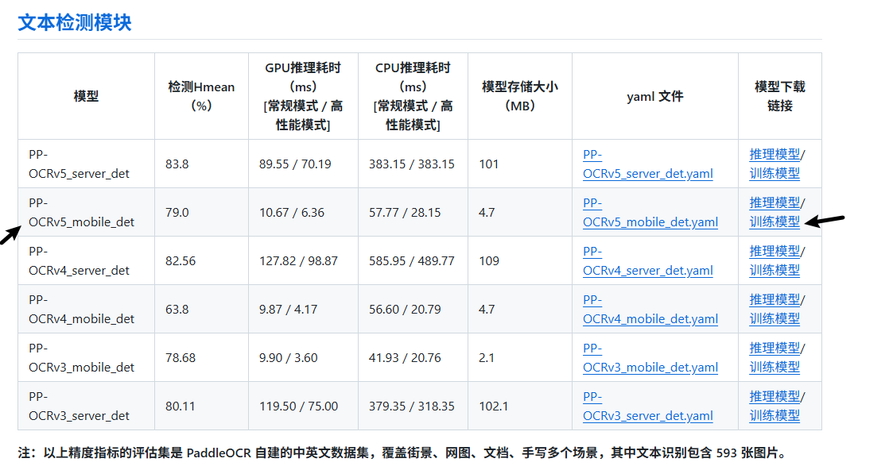
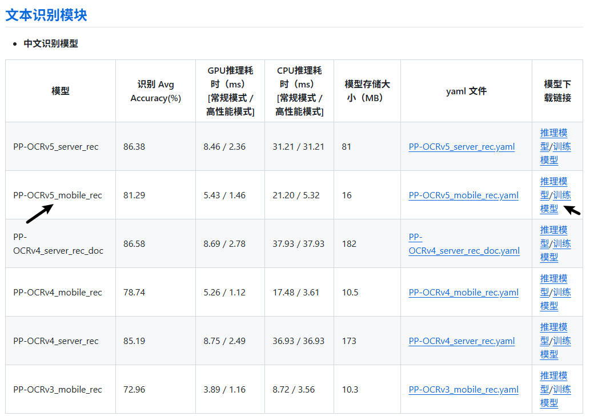

[PaddleOCR](https://github.com/PaddlePaddle/PaddleOCR/blob/main/readme/README_cn.md) 是业界领先、可直接部署的 OCR 与文档智能引擎，提供从文本识别到文档理解的全流程解决方案

> 项目背景：识别集装箱号

## 1 环境配置
当前使用的是虚拟环境：

- python：3.11
- paddlepaddle：3.1
- paddleocr：3.1.0

### 1.1 安装paddlepaddle
参考 [安装paddlepaddle](./01-介绍.md)

### 1.2 下载paddleocr

下载网站：https://github.com/PaddlePaddle/PaddleOCR/releases

当前使用的版本是 3.1.0

下载后解压

```bash
unzip PaddleOCR-3.1.0.zip 
```

安装依赖

```bash
cd PaddleOCR-3.1.0

pip install -r requirements.txt  --user
```

测试是否能正常运行：

```bash
python tools/infer/predict_system.py --image_dir="/workspace/img/" --use_angle_cls=True --use_space_char=True
```

输出以下内容即成功：

```
ppocr INFO: not find det model file path None
```


## 2 准备数据集

### 2.1 标注工具

1. [**PPOcrLabel**](https://github.com/PFCCLab/PPOCRLabel)，专门为 PPOCR 制作的标注工具，**推荐。**
    > 存在问题：EXE 安装包运行会报错。但是该工具在本地运行标注的话还是比较推荐的。

2. [**X-AnyLabeling**](https://github.com/CVHub520/X-AnyLabeling)，支持多种导出格式，其中就支持 PPOCR 的格式。

### 2.2 标注完毕后的数据集
```bash
conno/1b4e2845-e9ba-4233-9268-bf07801ace0e.jpg	[{"transcription": "RKSU5020243", "points": [[233, 317], [299, 317], [258, 833], [181, 839]], "difficult": false}]
conno/6ffd244b-1d27-4084-998b-e4d7ac076c5f.jpg	[{"transcription": "ZGXU6173701", "points": [[717, 448], [781, 419], [835, 980], [751, 996]], "difficult": false}]
conno/0ba730a8-052b-4662-88fa-bfd3c7dbd118.jpg	[{"transcription": "WHLU5706937", "points": [[565, 567], [915, 485], [915, 551], [578, 635]], "difficult": false}]
conno/8f50bf55-f825-43ac-87a5-f744aa3c2099.jpg	[{"transcription": "EISU9420010", "points": [[295, 744], [624, 747], [618, 813], [299, 806]], "difficult": false}]
conno/33e22c52-64b6-4715-87d9-d3a7823b97f7.jpg	[{"transcription": "SSKU1302201", "points": [[660, 676], [960, 671], [966, 724], [662, 737]], "difficult": false}]
conno/34a24249-7670-4be2-981f-19c502ee7da2.jpg	[{"transcription": "TKRU4507940", "points": [[660, 395], [724, 395], [717, 882], [619, 902]], "difficult": false}]
conno/67ead2d0-89c0-455c-aef0-49a76a3492aa.jpg	[{"transcription": "待识别", "points": [[585, 415], [589, 415], [593, 501], [917, 341], [893, 263]], "difficult": false}]
conno/78c58cfa-ff0f-4890-9fd9-07a0b639b9ca.jpg	[{"transcription": "LYGU3568255", "points": [[553, 393], [587, 491], [972, 334], [983, 245]], "difficult": false}]
conno/481aee74-f9ce-4145-a8c7-f4c1f45fcc75.jpg	[{"transcription": "RKSU4005584", "points": [[56, 298], [19, 935], [101, 937], [115, 280]], "difficult": false}]
conno/630d6e72-f99d-4922-8886-ea14f9e1a9bd.jpg	[{"transcription": "FCIU2682384", "points": [[562, 737], [572, 803], [867, 712], [858, 655]], "difficult": false}]
conno/9751b358-0b48-4006-8a73-89e816d37b67.jpg	[{"transcription": "CNIU2452605", "points": [[608, 801], [606, 867], [908, 837], [906, 773]], "difficult": false}]
```

## 3 准备预训练模型
如果已经有预训练模型的话，可以忽略这一步。

下载地址：https://github.com/PaddlePaddle/PaddleOCR/blob/release/3.1/docs/version3.x/model_list.md

如果报 404 的话，根据 版本 + 路径 进行查找即可。

根据情况选择 mobile 和 server 模型
- mobile: 训练速度快，精度较低，识别速度快
- server: 训练速度慢，精度较高，识别速度慢

### 3.1 文本检测训练模型



### 3.2 文本识别训练模型




## 错误情况
### ImportError: libGL.so.1: cannot open shared object file: No such file or directory

原因：缺少 `libGL.so.1` 库

解决方案：
```bash
sudo apt update
sudo apt install libgl1-mesa-glx
```

### all input arrays must have the same shap

原因：图像尺寸不一致

解决方案：
将 batch_size_per_card 设置为 1
```yaml
Eval:
  loader:
    batch_size_per_card: 1
```

### OSError: cannot open resource

原因：字体路径无效

解决方案：将paddleocr里面的字体放到系统字体路径下

```bash
cp /workspace/PaddleOCR-3.1.0/doc/fonts/simfang.ttf /usr/share/fonts/
```

