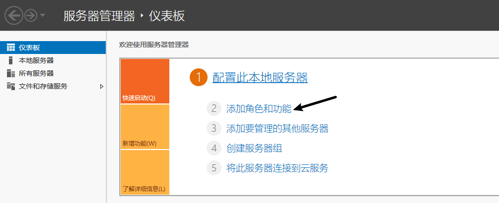
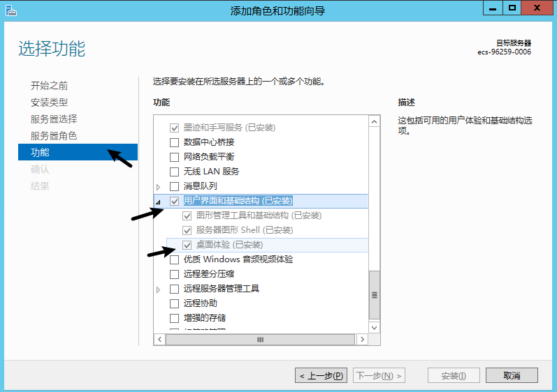
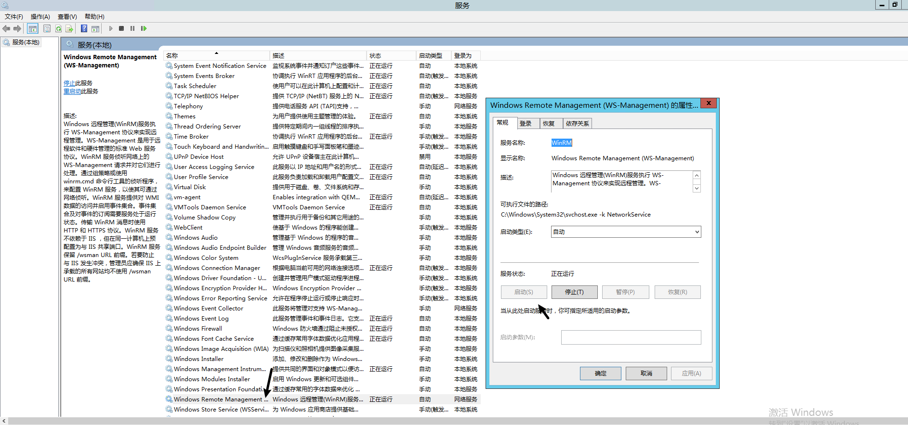
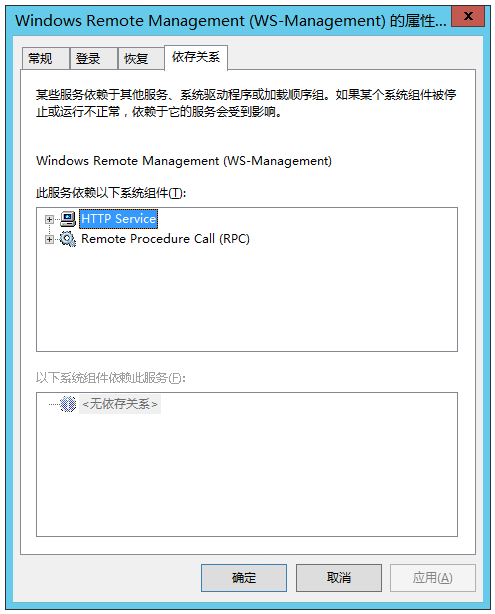

[PaddleX 3.0](https://paddlepaddle.github.io/PaddleX/latest/index.html) 是基于飞桨框架构建的低代码开发工具，它集成了众多**开箱即用的预训练模型**，可以实现模型从训练到推理的**全流程开发**，支持国内外**多款主流硬件**，助力AI 开发者进行产业实践。

## 1 环境配置
当前使用的是虚拟环境：

- python：3.11
- paddlepaddle：3.1
- paddleocr：3.1.0

### 1.1 安装paddlepaddle
参考 [安装paddlepaddle](./01-介绍.md)

### 1.2 安装paddlex
```bash
pip install "paddlex[base]"
```

## 2 部署项目

参考文档：https://paddlepaddle.github.io/PaddleX/latest/pipeline_deploy/serving.html#12

### 2.1 安装服务化部署插件
方便 java 等语言接口的调用
```bash
paddlex --install serving
```

### 2.2 生成配置文件
使用相关命令，其中 OCR 当前为通用 OCR 产线，需要不同的产线就修改不同的名称即可。

```bash
paddlex --get_pipeline_config OCR --save_path ./OCR.yaml
```

生成成功会提示

```bash
The pipeline config has been saved to: OCR.yaml
```

生成的默认配置如下：

```yaml
pipeline_name: OCR

text_type: general

use_doc_preprocessor: True
use_textline_orientation: True

SubPipelines:
  DocPreprocessor:
    pipeline_name: doc_preprocessor
    use_doc_orientation_classify: True
    use_doc_unwarping: True
    SubModules:
      DocOrientationClassify:
        module_name: doc_text_orientation
        model_name: PP-LCNet_x1_0_doc_ori
        model_dir: null
      DocUnwarping:
        module_name: image_unwarping
        model_name: UVDoc
        model_dir: null

SubModules:
  TextDetection:
    module_name: text_detection
    model_name: PP-OCRv5_server_det
    model_dir: null
    limit_side_len: 64
    limit_type: min
    max_side_limit: 4000
    thresh: 0.3
    box_thresh: 0.6
    unclip_ratio: 1.5
  TextLineOrientation:
    module_name: textline_orientation
    model_name: PP-LCNet_x1_0_textline_ori 
    model_dir: null
    batch_size: 6    
  TextRecognition:
    module_name: text_recognition
    model_name: PP-OCRv5_server_rec 
    model_dir: null
    batch_size: 6
    score_thresh: 0.0
```

**修改配置文件**

注意将训练好的模型路径配置 `./pipeline/rec_inference`  和 `./pipeline/det_inference`

```yaml
# 整体 pipeline 名称，用于识别产线名称
pipeline_name: OCR

# 文本类型，可选 general（通用）或 others，决定一些后处理策略
text_type: general

# 是否使用文档预处理模块（方向分类 + 扭曲矫正）
# 如无严重倾斜/扫描件，建议设为 False，可显著提升速度
use_doc_preprocessor: False

# 是否对检测出的文本行进行角度分类（如 0° / 90° / 180°）
# mobile 模型一般建议关闭
use_textline_orientation: False

# 正式的 OCR 主流程模块
SubModules:

  # 文本检测模块（通常是基于 DB 的检测器）
  TextDetection:
    module_name: text_detection
    model_name: PP-OCRv5_server_det   # 使用的是 server 版大模型，精度高但速度慢
    model_dir: ./pipeline/det_inference   # 本地模型文件夹路径（需包含 model.pdmodel 等）
    limit_side_len: 64               # 输入图最短边 resize 到此尺寸（可适当调大提高效果）
    limit_type: min
    max_side_limit: 4000            # 最长边最大不超过此值
    thresh: 0.3                     # 检测 binarize 阈值
    box_thresh: 0.6                 # 文本框置信度阈值
    unclip_ratio: 1.5               # DB 算法的后处理参数，控制框扩大比例

  # 文本识别模块（通常是 CRNN + CTC 或 SVTR 模型）
  TextRecognition:
    module_name: text_recognition
    model_name: PP-OCRv5_server_rec   # 同样使用的是 server 版识别模型
    model_dir: ./pipeline/rec_inference
    batch_size: 6                     # 一次识别图块的数量，适当调大可提高 GPU 利用率
    score_thresh: 0.0                 # 识别结果置信度下限，低于此不输出
```

### 2.3 运行服务器

通过 PaddleX CLI 运行服务器：

```bash
paddlex --serve --pipeline {产线名称或产线配置文件路径} [{其他命令行选项}]
```

参考命令:

```bash
paddlex --serve --pipeline .\OCR.yaml --device gpu:0 --port 8866
```

可以看到类似以下展示的信息，即代表成功

```
INFO:     Started server process [63108]
INFO:     Waiting for application startup.
INFO:     Application startup complete.
INFO:     Uvicorn running on http://0.0.0.0:8080 (Press CTRL+C to quit)
```

### 2.4 调用服务

对于服务提供的主要操作：

- HTTP请求方法为POST。
- 请求体和响应体均为JSON数据（JSON对象）。
- 当请求处理成功时，响应状态码为`200`，响应体的属性如下：

| 名称        | 类型      | 含义                          |
| :---------- | :-------- | :---------------------------- |
| `logId`     | `string`  | 请求的UUID。                  |
| `errorCode` | `integer` | 错误码。固定为`0`。           |
| `errorMsg`  | `string`  | 错误说明。固定为`"Success"`。 |
| `result`    | `object`  | 操作结果。                    |

- 当请求处理未成功时，响应体的属性如下：

| 名称        | 类型      | 含义                       |
| :---------- | :-------- | :------------------------- |
| `logId`     | `string`  | 请求的UUID。               |
| `errorCode` | `integer` | 错误码。与响应状态码相同。 |
| `errorMsg`  | `string`  | 错误说明。                 |

服务提供的主要操作如下：

- **`infer`**

获取图像OCR结果。

```
POST /ocr
```

- 请求体的属性如下：

| 名称                        | 类型      | 含义                                                         | 是否必填                                                     |
| :-------------------------- | :-------- | :----------------------------------------------------------- | :----------------------------------------------------------- |
| `file`                      | `string`  | 服务器可访问的图像文件或PDF文件的URL，或上述类型文件内容的Base64编码结果。默认对于超过10页的PDF文件，只有前10页的内容会被处理。 要解除页数限制，请在产线配置文件中添加以下配置：`Serving:  extra:    max_num_input_imgs: null ` | 是                                                           |
| `fileType`                  | `integer` | `null`                                                       | 文件类型。`0`表示PDF文件，`1`表示图像文件。若请求体无此属性，则将根据URL推断文件类型。 |
| `visualize`                 | `boolean` | `null`                                                       | 是否返回可视化结果图以及处理过程中的中间图像等。传入 `true`：返回图像。传入 `false`：不返回图像。若请求体中未提供该参数或传入 `null`：遵循产线配置文件`Serving.visualize` 的设置。 例如，在产线配置文件中添加如下字段： `Serving:  visualize: False `将默认不返回图像，通过请求体中的`visualize`参数可以覆盖默认行为。如果请求体和配置文件中均未设置（或请求体传入`null`、配置文件中未设置），则默认返回图像。 |
| `useDocOrientationClassify` | `boolean` | `null`                                                       | 请参阅产线对象中 `predict` 方法的 `use_doc_orientation_classify` 参数相关说明。 |
| `useDocUnwarping`           | `boolean` | `null`                                                       | 请参阅产线对象中 `predict` 方法的 `use_doc_unwarping` 参数相关说明。 |
|                             |           |                                                              |                                                              |
| `useTextlineOrientation`    | `boolean` | `null`                                                       | 请参阅产线对象中 `predict` 方法的 `use_textline_orientation` 参数相关说明。 |
| `textDetLimitSideLen`       | `integer` | `null`                                                       | 请参阅产线对象中 `predict` 方法的 `text_det_limit_side_len` 参数相关说明。 |
| `textDetLimitType`          | `string`  | `null`                                                       | 请参阅产线对象中 `predict` 方法的 `text_det_limit_type` 参数相关说明。 |
| `textDetThresh`             | `number`  | `null`                                                       | 请参阅产线对象中 `predict` 方法的 `text_det_thresh` 参数相关说明。 |
| `textDetBoxThresh`          | `number`  | `null`                                                       | 请参阅产线对象中 `predict` 方法的 `text_det_box_thresh` 参数相关说明。 |
| `textDetUnclipRatio`        | `number`  | `null`                                                       | 请参阅产线对象中 `predict` 方法的 `text_det_unclip_ratio` 参数相关说明。 |
| `textRecScoreThresh`        | `number`  | `null`                                                       | 请参阅产线对象中 `predict` 方法的 `text_rec_score_thresh` 参数相关说明。 |

- 请求处理成功时，响应体的`result`具有如下属性：

| 名称         | 类型     | 含义                                                         |
| :----------- | :------- | :----------------------------------------------------------- |
| `ocrResults` | `object` | OCR结果。数组长度为1（对于图像输入）或实际处理的文档页数（对于PDF输入）。对于PDF输入，数组中的每个元素依次表示PDF文件中实际处理的每一页的结果。 |
| `dataInfo`   | `object` | 输入数据信息。                                               |

`ocrResults`中的每个元素为一个`object`，具有如下属性：

| 名称                    | 类型     | 含义                                                         |
| :---------------------- | :------- | :----------------------------------------------------------- |
| `prunedResult`          | `object` | 产线对象的 `predict` 方法生成结果的 JSON 表示中 `res` 字段的简化版本，其中去除了 `input_path` 和 `page_index` 字段。 |
| `ocrImage`              | `string` | `null`                                                       |
| `docPreprocessingImage` | `string` | `null`                                                       |
| `inputImage`            | `string` | `null`                                                       |


**Java调用实例**

```java
package cn.g3soft;

import okhttp3.*;
import com.fasterxml.jackson.databind.ObjectMapper;
import com.fasterxml.jackson.databind.JsonNode;
import com.fasterxml.jackson.databind.node.ObjectNode;

import javax.imageio.IIOImage;
import javax.imageio.ImageIO;
import javax.imageio.ImageWriteParam;
import javax.imageio.ImageWriter;
import javax.imageio.stream.ImageOutputStream;

import java.awt.image.BufferedImage;
import java.io.*;
import java.util.Base64;

public class Test {

    public static void main(String[] args) throws IOException {
        String API_URL = "http://localhost:8866/ocr";
        String imagePath = "D:\\code\\python-project\\boxocr\\100-2\\20241004082017A007.jpg";

        // 压缩并限制最大500KB大小
        long maxSizeBytes = 500 * 1024;

        long compressStart = System.currentTimeMillis();
        byte[] compressedBytes = compressImageToMaxSize(imagePath, maxSizeBytes);
        long compressEnd = System.currentTimeMillis();
        System.out.println("Image compression time: " + (compressEnd - compressStart) + " ms");
        System.out.println("Compressed image size: " + compressedBytes.length + " bytes");

        String base64Image = Base64.getEncoder().encodeToString(compressedBytes);

        ObjectMapper objectMapper = new ObjectMapper();
        ObjectNode payload = objectMapper.createObjectNode();
        payload.put("file", base64Image);
        payload.put("fileType", 1);

        OkHttpClient client = new OkHttpClient();
        MediaType JSON = MediaType.get("application/json; charset=utf-8");
        RequestBody body = RequestBody.create(JSON, payload.toString());

        long ocrStart = System.currentTimeMillis();
        Request request = new Request.Builder()
                .url(API_URL)
                .post(body)
                .build();

        try (Response response = client.newCall(request).execute()) {
            long ocrEnd = System.currentTimeMillis();
            System.out.println("OCR request elapsed time: " + (ocrEnd - ocrStart) + " ms");

            if (response.isSuccessful()) {
                String responseBody = response.body().string();
                JsonNode root = objectMapper.readTree(responseBody);
                JsonNode result = root.get("result");

                JsonNode ocrResults = result.get("ocrResults");
                for (int i = 0; i < ocrResults.size(); i++) {
                    JsonNode item = ocrResults.get(i);

                    JsonNode prunedResult = item.get("prunedResult");
                    System.out.println("Pruned Result [" + i + "]: " + prunedResult.toString());

                    // 提取 rec_texts 和 rec_scores
                    JsonNode recTextsNode = prunedResult.get("rec_texts");
                    JsonNode recScoresNode = prunedResult.get("rec_scores");

                    if (recTextsNode != null && recScoresNode != null && recTextsNode.isArray() && recScoresNode.isArray()) {
                        System.out.println("rec_texts:");
                        for (JsonNode textNode : recTextsNode) {
                            System.out.println("  " + textNode.asText());
                        }
                        System.out.println("rec_scores:");
                        for (JsonNode scoreNode : recScoresNode) {
                            System.out.println("  " + scoreNode.asDouble());
                        }
                    } else {
                        System.out.println("rec_texts or rec_scores not found or invalid format.");
                    }

                    // 保存 OCR 图片为文件
                    String ocrImageBase64 = item.get("ocrImage").asText();
                    byte[] ocrImageBytes = Base64.getDecoder().decode(ocrImageBase64);
                    String ocrImgPath = "ocr_result_" + i + ".jpg";

                    try (FileOutputStream fos = new FileOutputStream(ocrImgPath)) {
                        fos.write(ocrImageBytes);
                        System.out.println("Saved OCR image to: " + ocrImgPath);
                    }
                }
            } else {
                System.err.println("Request failed with HTTP code: " + response.code());
            }
        }
    }

    /**
     * 压缩图片，最大限制文件大小，不超过maxFileSizeBytes
     * 通过递减压缩质量尝试实现大小限制，最低质量0.1
     */
    public static byte[] compressImageToMaxSize(String imagePath, long maxFileSizeBytes) throws IOException {
        File file = new File(imagePath);
        BufferedImage image = ImageIO.read(file);
        if (image == null) {
            throw new IOException("Failed to read image from " + imagePath);
        }

        ImageWriter jpgWriter = ImageIO.getImageWritersByFormatName("jpg").next();
        ImageWriteParam jpgWriteParam = jpgWriter.getDefaultWriteParam();
        jpgWriteParam.setCompressionMode(ImageWriteParam.MODE_EXPLICIT);

        float quality = 0.9f;
        ByteArrayOutputStream baos = new ByteArrayOutputStream();

        while (quality >= 0.1f) {
            baos.reset();
            jpgWriteParam.setCompressionQuality(quality);

            try (ImageOutputStream ios = ImageIO.createImageOutputStream(baos)) {
                jpgWriter.setOutput(ios);
                jpgWriter.write(null, new IIOImage(image, null, null), jpgWriteParam);
            }

            if (baos.size() <= maxFileSizeBytes) {
                jpgWriter.dispose();
                return baos.toByteArray();
            }
            quality -= 0.05f;
        }
        // 质量降至最低仍未达到限制，返回最后压缩结果
        jpgWriter.dispose();
        return baos.toByteArray();
    }
}
```


## 错误情况

### Please use PaddlePaddle with GPU version.
原因：当前 PaddlePaddle 版本不是GPU的，而是CPU的。

解决方法：安装GPU版本的PaddlePaddle

### ImportError：DLL load failed while importing cv2：找不到指定的模块
当前环境：Windows Server 2012

**安装 Microsoft Visual C++ Redistributable**

- OpenCV 依赖于 Microsoft Visual C++ Redistributable 运行时库。如果这些库缺失，可能会导致 DLL 加载失败。
- 下载并安装最新版本的 Microsoft Visual C++ Redistributable：
  - [Visual C++ Redistributable for Visual Studio 2015, 2017 and 2019（64 位系统）](https://aka.ms/vs/16/release/vc_redist.x64.exe)
  - [Visual C++ Redistributable for Visual Studio 2015, 2017 and 2019（32 位系统）](https://aka.ms/vs/16/release/vc_redist.x86.exe)

**检查 Python 和 OpenCV 的位数是否匹配**
- 确保你安装的 Python 版本（32 位或 64 位）与 OpenCV 的位数一致。
- 你可以通过以下命令检查 Python 的位数：
  ```bash
  python -c "import struct; print(struct.calcsize('P') * 8)"
  ```
- 如果不匹配，卸载并重新安装正确位数的 Python 和 OpenCV。
安装完成后，重启计算机。

**一定要打开桌面实验**
1. 打开服务器面板，选择 **添加角色和功能**
   
2. 在功能处开启 **桌面体验**
   

如果开启 桌面体验 报错：**尚未开启 WinRM 服务**， 这个时候需要开启 `Windows Remote Management (WS-Management) `


如果在开启过程中报错：**错误1068:依存服务或组无法启动**

点击属性，找到 **依存关系**，确保依赖的服务已开启



检查 `HTTP Service` 服务是否启动
```bash
sc query http
```

如果出现 `STATE : 1 STOPPED` ，那么就代表该服务已被禁用，解决方案如下：
1. 启用 HTTP 服务
   ```bash
   sc config http start= auto
   ```
2. 启动 HTTP
   ```bash
   net start http
   ```
3. 验证，应该输出 `STATE : RUNNING`
   ```bash
   sc query http
   ```
4. 重建 WinRM（必须）
   ```bash
   winrm invoke Restore winrm/Config @{}
   winrm quickconfig -q
   ```